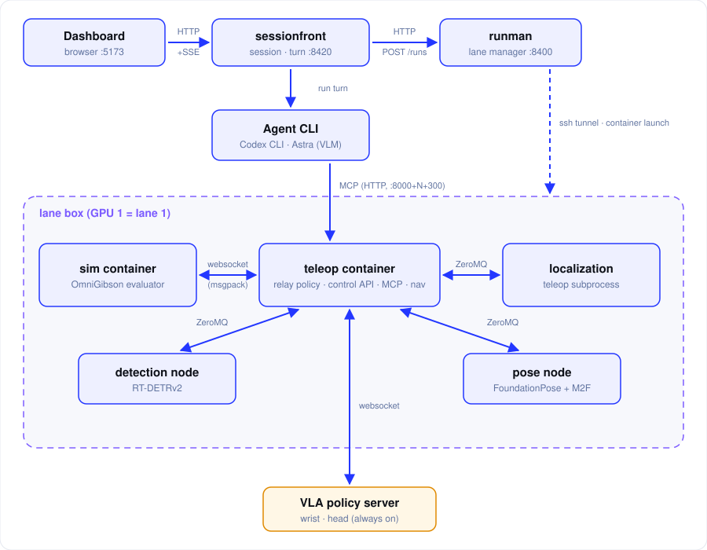

## 한눈에 보기

Dashboard, sessionfront, runman, lane box 사이는 **HTTP 계열**(HTTP, SSE, SSH tunnel)로, lane box 안의 evaluator, teleop, 각 node, VLA policy server 사이는 **WebSocket과 ZeroMQ**로 연결합니다. 구간마다 누가 누구와, 얼마나 자주, 어떤 데이터를 주고받는지가 달라서 한 가지 방식으로 통일하지 않고 그 성격에 맞는 방식을 골랐습니다.

| 구간 | 방식 | 이유 |
|---|---|---|
| Dashboard → sessionfront | HTTP + SSE | 요청은 HTTP로 충분하고, 진행 상황은 sessionfront에서 Dashboard로 흐르는 단방향 스트림 |
| sessionfront → runman | HTTP (즉시 202) | lane boot에 약 270초가 걸려서 응답을 붙잡아 둘 수 없음 |
| runman → lane box | SSH tunnel | lane box가 원격 GPU 머신이라 이미 쓰는 SSH로 포트를 끌어오면 됨 |
| Agent ↔ teleop | MCP (HTTP) | Agent가 도구를 부르는 표준 방식 |
| Agent ↔ dataset | MCP (stdio) | 같은 머신의 보조 프로세스라 포트가 필요 없음 |
| evaluator ↔ teleop | WebSocket + msgpack | OmniGibson evaluator가 정해 둔 프로토콜 |
| teleop ↔ localization, detection, pose node | ZeroMQ (ipc) | 같은 호스트라서 마운트만으로 연결, 데이터 성격별 패턴 선택 |
| teleop ↔ VLA policy server | WebSocket | 상시 가동 중인 VLA policy server에 연결을 유지하며 반복 호출 |

## 1. Agent ↔ teleop: MCP

Agent(VLM은 Astra, Codex CLI로 실행)는 teleop의 도구를 **MCP**로 호출합니다. 도구의 상태가 Agent 밖에 있어야 하기 때문입니다.

- turn 하나가 CLI 하위 프로세스 하나라서, turn이 끝나면 Agent 프로세스도 끝납니다. 반면 episode는 turn 한 번으로 끝나지 않고 lane의 상태(teleop)는 계속 이어져야 합니다. 그래서 도구를 Agent 안에 넣지 않고 lane 쪽 teleop MCP에 두었습니다.
- nav 도구도 같은 teleop MCP 안에 있어서, nav용 MCP를 따로 붙일 필요가 없습니다.
- 대화형 하네스와 제출용 eval-server가 같은 teleop 도구 코드를 씁니다.
- 도구 호출 한 번이 오래 걸릴 수 있어서 teleop MCP의 타임아웃을 420초로 넉넉히 잡았습니다.

## 2. evaluator ↔ teleop: WebSocket + msgpack

evaluator와는 upstream v3.9.3 프로토콜 그대로 **WebSocket + msgpack**으로 붙습니다. 고른 것이 아니라 맞춘 것입니다.

- OmniGibson evaluator는 policy server에 WebSocket client로 접속하는 구조입니다. evaluator를 고치지 않으려면 teleop이 그 policy server 자리에 들어가야 합니다.
- 다만 teleop은 스스로 행동을 내지 않고, **Agent가 시킨 행동만 전달하는 relay policy**입니다. 정책 역할은 Agent가 맡습니다.
- msgpack은 이미지나 배열 같은 바이너리를 JSON보다 작고 빠르게 실어 나릅니다.

## 3. teleop ↔ node: ZeroMQ (ipc)

teleop과 localization, detection, pose node는 **ZeroMQ ipc 소켓**으로 묶습니다. 전부 같은 호스트의 컨테이너이기 때문입니다.

- 호스트의 `/tmp/runman-<run_id>-channels` 디렉터리를 컨테이너의 `/channels`에 마운트하면 연결됩니다. 네트워크 포트를 따로 열 필요가 없습니다.
- 데이터 성격에 맞춰 패턴을 달리 골랐습니다.

| 채널 | 패턴 | 이유 |
|---|---|---|
| pose, obstacles, detections | PUB/SUB, 최신 값만 유지 | 옛 값은 의미가 없고 항상 최신 값만 필요함 |
| frames, images | PUB/SUB | 센서 데이터를 계속 흘려 보내기만 하면 됨 |
| odometry | PUSH/PULL | 한 방향으로 빠짐없이 전달함 |
| calls | REQ/REP | pose node에 instances, estimate를 요청하고 결과를 받아야 함 |

## 4. runman ↔ lane box: SSH tunnel

runman은 **SSH tunnel**로 lane의 제어 포트를 로컬로 끌어옵니다. lane box가 원격 GPU 머신에 있기 때문입니다.

- runman은 이미 SSH로 lane box에 붙어서 컨테이너를 띄웁니다. 같은 SSH로 포트를 끌어오면 별도로 포트를 열거나 인증을 만들 필요가 없습니다.
- 제어 포트는 로컬의 임의 포트로 끌어오고, rewind lane이면 rewind shim(`8700+gpu`)도 함께 끌어옵니다.

## 5. 비동기 처리: 즉시 202

lane boot와 turn 실행은 **요청을 받자마자 202를 돌려주고**, 진행 상황은 따로 알려줍니다. 둘 다 요청 하나가 끝날 때까지 기다리기엔 너무 길기 때문입니다.

- sessionfront가 runman에 `POST /runs`로 lane을 요청하면 바로 `202 booting`이 돌아오고, boot에 약 270초 걸립니다. 빈 GPU가 없으면 503입니다.
- Dashboard가 sessionfront에 `POST .../turns`로 turn을 보내도 202이고, turn이 이미 돌고 있거나 session이 끝났으면 409입니다.
- 진행 상황은 SSE로 Dashboard에 흘려 보냅니다. episode 종료는 sessionfront가 5초마다 runman의 결과를 확인해서 session을 `finished`로 바꿉니다.

## 6. lane 포트 규칙

lane 번호 N만 알면 모든 포트가 계산되도록 **규칙으로 고정**했습니다.

- `8000+N`: evaluator ↔ teleop WebSocket
- `8000+N+300`: teleop control API와 `/mcp`. +100이 아닌 이유는 8100을 datahub가 쓰고 있어서입니다.
- `8700+gpu`: rewind shim (rewind lane만)

lane이 여러 개 떠도 포트가 겹치지 않고, 어느 lane에 접속할지 바로 알 수 있습니다.
