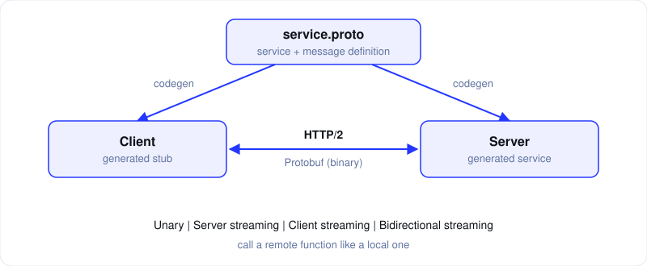
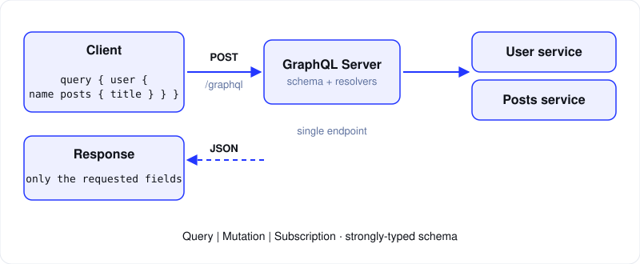
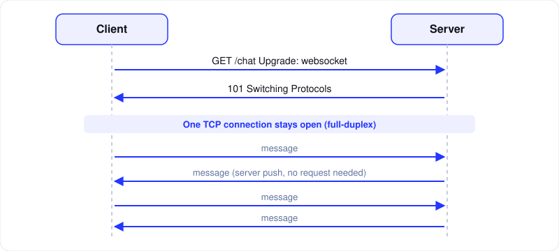

아래 두 게시물에서 다룬 주제 중 **gRPC, GraphQL, WebSocket** 세 가지만 골라 정리했습니다.

- [Top 8 API Styles](https://www.instagram.com/p/DcP6dFwPtvm/) — AlgoMaster.io
- [20 Must-Know Networking Concepts](https://www.instagram.com/p/Ddlswc5PnDv/) — AlgoMaster.io

> 두 게시물은 항목 이름만 나열한 영상이라, 자세한 설명은 일반적으로 알려진 내용으로 채웠습니다. 도식은 직접 그렸습니다.

## 먼저 구분하기

세 가지는 같은 종류가 아닙니다. 그래서 서로 대체재라기보다 **문제에 따라 고르는 도구**에 가깝습니다.

| | 정체 |
|---|---|
| **gRPC** | RPC 프레임워크 (HTTP/2 + Protocol Buffers) |
| **GraphQL** | API 쿼리 언어 + 런타임 (전송은 보통 HTTP) |
| **WebSocket** | 양방향 전송 프로토콜 (HTTP로 시작해 업그레이드) |

## 1. gRPC

Google이 만든 RPC 프레임워크입니다. 원격 서버의 함수를 **로컬 함수처럼 호출**합니다.



**동작 방식**

1. `.proto` 파일에 서비스와 메시지 타입을 정의합니다.
2. 이 파일에서 클라이언트(stub)와 서버 코드가 **자동 생성**됩니다.
3. 호출은 **HTTP/2** 위에서 **Protocol Buffers(바이너리)** 로 직렬화되어 오갑니다.

```proto
service UserService {
  rpc GetUser (GetUserRequest) returns (User);
}

message GetUserRequest { int64 id = 1; }
message User { int64 id = 1; string name = 2; }
```

**통신 방식 4가지**

- **Unary**: 요청 1개, 응답 1개
- **Server streaming**: 요청 1개, 응답 여러 개
- **Client streaming**: 요청 여러 개, 응답 1개
- **Bidirectional streaming**: 양쪽이 동시에 계속 주고받기

**장점**

- 바이너리 포맷이라 JSON보다 **작고 빠릅니다**.
- `.proto`가 곧 계약서라 **강한 타입**과 **다언어 코드 생성**이 됩니다.
- HTTP/2 **멀티플렉싱**으로 한 연결에서 여러 요청을 처리합니다.
- Deadline, 취소, 인증 같은 기능이 기본으로 있습니다.

**단점**

- 브라우저에서 직접 호출할 수 없어 **gRPC-Web**과 프록시가 필요합니다.
- 바이너리라 **눈으로 확인하며 디버깅**하기 어렵습니다.
- HTTP 캐시, curl 같은 일반 도구와 궁합이 좋지 않습니다.
- HTTP/2 연결을 오래 유지해서, L4 로드밸런서에서는 요청이 한 서버로 쏠릴 수 있습니다. L7 프록시나 클라이언트 측 로드밸런싱이 필요합니다.

**어울리는 곳**: 서비스 간 내부 통신(마이크로서비스), 지연 시간이 중요한 호출, 스트리밍

## 2. GraphQL

Facebook이 만든 API 쿼리 언어입니다. 보통 **단일 엔드포인트**(`/graphql`) 하나로, 클라이언트가 **필요한 필드만 골라** 요청합니다.



**해결하려는 문제**

- **Over-fetching**: 쓰지 않는 필드까지 받아오는 문제
- **Under-fetching**: 한 화면을 그리려고 요청을 여러 번 보내는 문제

```graphql
query {
  user(id: 1) {
    name
    posts { title }
  }
}
```

요청한 `name`과 `posts.title`만 JSON으로 돌아옵니다.

**핵심 개념**

- **Schema**: 타입과 필드를 정의하는 강타입 계약 (SDL)
- **Query / Mutation / Subscription**: 조회 / 변경 / 실시간 구독
- **Resolver**: 각 필드의 값을 가져오는 함수

**장점**

- 요청 한 번에 **연관 데이터**를 가져옵니다.
- 스키마가 곧 문서이고, introspection으로 도구가 자동 완성을 지원합니다.
- 서버를 고치지 않고도 프론트엔드가 응답 모양을 바꿀 수 있습니다.

**단점**

- **N+1 문제**: resolver가 항목마다 쿼리를 날리기 쉽습니다. DataLoader로 배치 처리합니다.
- 보통 POST 하나로 통신해서 **HTTP 캐싱**이 어렵습니다.
- 너무 깊거나 큰 쿼리를 막으려면 depth/complexity 제한이 필요합니다.
- 에러가 HTTP 200으로 오는 경우가 많아 모니터링에 주의해야 합니다.

**어울리는 곳**: 웹/모바일 등 클라이언트가 여러 종류이고 데이터 관계가 복잡한 서비스

## 3. WebSocket

HTTP로 시작해서 **Upgrade 핸드셰이크**를 거친 뒤, 하나의 TCP 연결 위에서 **양방향(full-duplex)** 으로 통신합니다. (`ws://`, `wss://`, RFC 6455)



**동작 방식**

1. 클라이언트가 `Upgrade: websocket` 헤더로 HTTP 요청을 보냅니다.
2. 서버가 `101 Switching Protocols`로 응답합니다.
3. 이후 **연결이 열린 채로 유지**되며, 양쪽이 언제든 메시지를 보냅니다.

```js
const ws = new WebSocket('wss://example.com/chat');
ws.onopen = () => ws.send('hello');
ws.onmessage = (e) => console.log(e.data);
```

**장점**

- 서버가 요청 없이도 **먼저 데이터를 푸시**할 수 있습니다.
- 연결 이후에는 메시지마다 HTTP 헤더를 반복해서 보내지 않아 **오버헤드가 작고 지연이 낮습니다**.
- 브라우저가 기본 지원합니다.

**단점**

- 연결이 **상태를 가져서(stateful)** 서버를 여러 대로 늘리기 어렵습니다. sticky session이나 Redis 같은 메시지 브로커로 서버 간 이벤트를 전달해야 합니다.
- **재연결과 하트비트(ping/pong)** 를 직접 구현해야 합니다.
- 일부 프록시와 방화벽에서 문제가 생길 수 있습니다.
- 연결 수만큼 서버 자원을 계속 점유합니다.

**어울리는 곳**: 채팅, 실시간 협업, 온라인 게임, 시세와 알림

## 비교

| | gRPC | GraphQL | WebSocket |
|---|---|---|---|
| 전송 | HTTP/2 | 주로 HTTP (구독은 WebSocket 위) | TCP (HTTP 업그레이드) |
| 데이터 형식 | Protobuf (바이너리) | JSON | 자유 (텍스트/바이너리) |
| 통신 방향 | 요청/응답 + 스트리밍 4종 | 요청/응답 (+구독) | 양방향 |
| 브라우저 | 프록시 필요 | 바로 가능 | 바로 가능 |
| 연결 | 요청 단위 | 요청 단위 | 영속 연결 |
| 강점 | 속도, 타입 계약 | 유연한 조회 | 실시간 |
| 약점 | 디버깅, 브라우저 | 캐싱, N+1 | 확장성, 상태 관리 |

## 어떻게 고를까

- 서버끼리 빠르고 타입이 명확하게 통신해야 한다 → **gRPC**
- 클라이언트마다 필요한 데이터가 다르고 관계가 복잡하다 → **GraphQL**
- 서버가 즉시 푸시하고 양쪽이 계속 주고받아야 한다 → **WebSocket**

## 같이 알아두면 좋은 네트워크 개념

첫 번째 게시물의 네트워킹 20개 개념 중, 위 세 가지와 직접 이어지는 것만 추렸습니다.

- **TCP**: WebSocket이 올라가는 연결 지향 전송 계층입니다.
- **HTTP/HTTPS**: gRPC(HTTP/2), GraphQL(HTTP), WebSocket(HTTP 업그레이드) 모두의 출발점입니다.
- **TLS**: `wss://`와 gRPC의 암호화 채널을 만듭니다.
- **Load Balancers**: 영속 연결(WebSocket)과 HTTP/2 장기 연결(gRPC)에서는 분산 방식을 따로 고민해야 합니다.

## 정리 질문

- **gRPC가 REST보다 빠른 이유는?** 바이너리 직렬화, HTTP/2 멀티플렉싱, 헤더 압축 덕분입니다.
- **GraphQL의 N+1은 어떻게 푸나?** DataLoader로 같은 종류의 조회를 모아 배치 처리합니다.
- **WebSocket 서버를 여러 대로 늘리려면?** 연결이 서버에 붙으니 메시지 브로커(Redis pub/sub 등)로 서버 간에 이벤트를 전파합니다.
