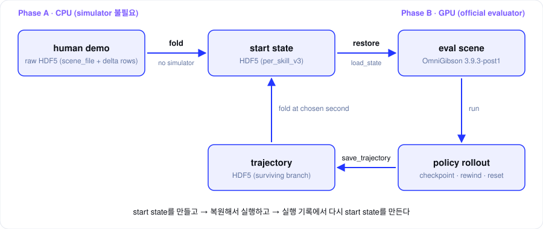

## 결론

**demo의 raw HDF5를 시뮬레이터 없이 CPU에서 다시 쌓아(fold) 원하는 프레임의 sim 상태를 만들고, 그 상태를 OmniGibson이 읽는 직렬화 벡터 그대로 HDF5에 저장했다가 평가할 때 eval scene에 복원한다.** 이렇게 한 이유는 두 가지다.

- **빠르다.** 상태는 이미 기록에 들어 있어서 덮어쓰기만 하면 된다. 시뮬레이터를 돌릴 필요가 없어서 demo 하나에 2–3초이고, 예전 GPU 추출은 13–20분 걸렸다.
- **복원이 단순하다.** OmniGibson이 직접 읽는 포맷 그대로 저장하니 별도 변환 없이 `load_state`로 올릴 수 있다.



| 단계 | 하는 일 | 실행 환경 |
|---|---|---|
| Phase A | raw HDF5 → fold → start state HDF5 | CPU |
| Phase B | start state HDF5 → 복원 → 평가 | GPU, 공식 evaluator |

## 1. 저장하는 것은 float32 벡터 하나다

**sim 상태는 `og.sim.dump_state(serialized=True)`가 만드는 float32 벡터 하나로 저장한다.** 왜냐하면 OmniGibson이 이 형식을 그대로 읽을 수 있기 때문이다.

```
[scene pos(3), scene ori(4)]
[레지스트리 수(=2)]
  [uuid("system_registry"), 시스템 수]  { [uuid(시스템명)], payload } × N
  [uuid("object_registry"), 오브젝트 수] { [uuid(오브젝트명)], payload } × M
```

- 키는 `uuid(name) = md5(name) % 1e8`이다. 이름이 곧 키다.
- 벡터에 **길이 정보가 없다.** 같은 scene의 오브젝트 레이아웃이 있어야만 읽을 수 있다. start state만으로는 장면을 만들 수 없고, 같은 task의 scene이 먼저 로드돼 있어야 하는 이유다.

| payload | 들어 있는 것 |
|---|---|
| 오브젝트 | `is_asleep`, root pos/ori, 동적 오브젝트의 선속도·각속도, 관절 위치·속도, non-kin 상태(`ToggledOn`, `Temperature`, `AttachedTo`, `ModifiedParticles` 등) |
| 로봇 (추가) | 컨트롤러 6개의 goal·필터, assisted grasp 블록 |
| 파티클 시스템 | physical, visual, micro 세 종류. 위치·회전·스케일, `particle_counter`, 좌표계 표시값 |

## 2. 원본은 demo의 raw HDF5다

**raw HDF5는 첫 시점의 전체 상태와, 그 뒤 달라진 부분만 적은 행(delta row)으로 이루어져 있다.**

| 위치 | 내용 |
|---|---|
| `data.attrs["scene_file"]` | 기록 시작 시점의 전체 상태 dict와 오브젝트별 레이아웃 (root link가 동적인지, 관절 수, non-kin 상태 이름과 순서, 컨트롤러) |
| `data/demo_N/state[f]` | 프레임 f의 delta 행. 이전 행과 달라진 오브젝트·시스템만 있다 |
| `data/demo_N/state_size[f]` | 그 행의 실제 길이 |
| `data/demo_N/action[f]` | 23차원 action |
| `attrs["transitions"]` | demo 도중 오브젝트·시스템이 생기거나 없어진 기록 (예: 자르면 반쪽 생성) |

- 행에는 엔트리 길이가 적혀 있지 않아서, `scene_file`의 레이아웃으로 각 엔트리를 끝까지 읽어야 한다.
- demo 도중 생긴 오브젝트는 레이아웃이 없다. 이 경우 가능한 분할을 전부 시도하고, **모든 레지스트리의 엔트리 수가 맞고 행을 정확히 다 소비하는 분할이 딱 하나일 때만** 받아들인다. 0개나 2개 이상이면 에러다. 실측으로 100개 기록의 행 1,062,130개가 전부 한 가지로만 분할됐다.

## 3. 중간 상태는 fold로 만든다

**프레임 F의 상태는 `scene_file`의 초기값 위에 0번부터 F번 행을 차례로 덮어써서 얻는다.** 왜냐하면 각 행에 바뀐 것만 들어 있어서, 순서대로 덮으면 그 시점의 전체 상태가 되기 때문이다.

1. **초기값**: `scene_file`의 시작 dict를 기록 레이아웃의 벡터로 만든다.
2. **행 누적**: 0번 행부터 F번 행까지 읽으면서 오브젝트·시스템의 최신 payload를 덮어쓴다. 앞으로만 진행하므로, 요청한 프레임을 정렬해서 한 번에 지나가며 찍는다.
3. **transition 처리**: transition k는 action k 도중에 일어나서 행 k에는 아직 지워질 것이 남아 있다. 그래서 행 k+1을 쌓기 전에 k에서 지워진 오브젝트·시스템을 뺀다.
4. **keep_still**: 프레임 F 행에 없던 오브젝트는 upstream playback과 같은 상태로 쓴다. 깨어 있음, 선속도·각속도 0, 관절 속도 0이고, 나머지는 마지막 기록값이다.
5. **캡처 시점**: `capture_phase = pre_step`, 즉 프레임 F의 policy step 직전 상태다.

같은 fold를 우리 rollout의 기록에도 그대로 쓴다. 원하는 초(`k = round(초 × 30)`)의 행까지 쌓으면 rollout 도중 상태를 새 start state로 만들 수 있다. 다만 3.9.3 recorder가 기록한 rollout만 받고, 다른 버전이나 transition이 있는 rollout은 거부한다.

## 4. 버전 차이는 3.9.3 레이아웃으로 맞춘다

**기록은 예전 버전(1.2, 3.7, 3.8 등)이고 eval은 3.9.3-post1이라서, 저장할 때 3.9.3 레이아웃으로 변환한다.**

- **레이아웃 기록**: 3.9.3은 오브젝트에 기록된 non-kin 순서가 있으면 그 순서대로 읽는다. 그래서 파일에 오브젝트별 상태 이름과 순서(`non_kin_layout`)를 저장한다.
- **step → 초**: 3.9.3에서 `ToggledOn`의 손 들어감 카운터와 `SlicerActive`의 `delay_counter`가 초 단위가 됐다. 기록된 카운트를 30으로 나눈다.
- **예전 기록기 규칙**: grill 계열의 `Temperature`는 버리고, toaster에는 실온(23.0)을 추가하고, 개수가 0인 `ModifiedParticles`는 버린다.
- **파생 상태**: `AABB`, `Open`, `OnFire`, `HeatSourceOrSink`는 3.9.3이 불러올 때 쓰지 않으므로 빠져도 손실이 없다. 그 밖의 상태가 없으면 복원 전에 에러를 낸다.
- 실측으로 1,236개를 변환했고, 그중 오프라인으로 다시 만든 1,204개와 비트 단위로 같았다.

## 5. 저장 형식은 `per_skill_v3`다

**skill마다 시작 상태 벡터를 담은 HDF5 하나를 만든다.** 시작과 끝, demo 정보, 원본 정보를 모두 한 파일에 넣어서 파일만 보고도 어떤 기록에서 나왔는지 알 수 있게 했다.

| 위치 | 내용 |
|---|---|
| `data/skill_state_{k}` | k번째 skill 시작 상태 벡터 (lzf 압축) |
| `data/skill_end_state_{k}` | 끝 상태 (기록된 경우) |
| `data/transitions_json` | demo transition 원문 |
| `data.attrs["skills"]` | skill별 구간(`start_frame`, `end_frame`, `horizon`, `capture_phase`), 대상 물체, instruction |
| `data.attrs["non_kin_layout"]` | 오브젝트별 non-kin 상태 이름과 순서 |
| `data.attrs["provenance"]` | 원본 raw, annotation 등의 sha256 |
| `data.attrs["status"]` | `complete`이어야 읽을 수 있음 |

**읽을 때는 아래 중 하나라도 해당하면 거부한다.** 불완전하거나 형식이 맞지 않는 파일로 평가가 돌아가는 것을 막기 위해서다.

- 파일 이름에 `.partial.`이 있거나 `status`가 `complete`가 아님
- `non_kin_layout`이 없음 (3.9.2 시절 파일)
- 캡처한 skill 수가 기대치와 다름
- `pre_step`이 아니거나, `source_state_frame`이 start와 다르거나, horizon이 맞지 않음

## 6. 불러올 때는 복원하고 검증한다

**start state는 로드만 하지 않고, 복원 → 보정 → 안정화 → 유효성 검사까지 거쳐야 평가에 쓸 수 있다.** 복원한 상태가 정확하지 않으면 정책이 잘못된 출발점에서 평가받기 때문이다.

1. **scene 초기화**: 앞 skill이 주입한 오브젝트와 파티클 시스템을 지운다. 남아 있으면 다음 `load_state`가 망가져서 뒤쪽 skill이 줄줄이 실패한다. `ev.reset()` 뒤 시작 전 transition을 재생한다.
2. **로봇 이름 맞추기**: demo 로봇 이름의 uuid와 레이아웃 키를 eval 로봇 이름으로 바꾼다.
3. **복원**: 파일의 레이아웃으로 `sim.deserialize`를 하고(벡터를 정확히 다 소비해야 한다), `sim.load_state` 뒤 upstream 버그 우회 4개를 적용한다.
   - 물리 파티클이 구 반지름만큼 어긋나는 문제
   - 시각 파티클 순서가 뒤섞이는 문제
   - 파티클 이름 카운터가 줄어드는 문제
   - 붙어 있는 물체의 속도가 0으로 리셋되는 문제
4. **round-trip 검증**: 복원 직후 dump와 비교한다. 최대 오차가 약 1e-6이면 깨끗하게 복원된 것이다. 벡터끼리 비교하지 않고 엔트리 단위로 비교하는 이유는 파일이 기록 당시 scene 기준이고 eval scene에는 방이 더 있어서 길이가 다르기 때문이다. 쿼터니언 q와 -q는 같은 회전으로 본다.
5. **드라이브 맞추기**: 관절 드라이브 목표를 복원된 자세로 바꾸고 1 step 진행한다. 안 하면 팔이 이전 목표로 튄다.
6. **잡기 복구**: 기록에 grasp가 있으면 그대로 쓰고, 없으면 skill별로 넘겨 받은 물체로 assisted grasp를 다시 건다. 추측으로는 다시 잡지 않는다.
7. **안정화와 유효성 검사**: 5 step 동안 팔 drift, scene 변화, 떨어지거나 5mm 넘게 밀린 물체를 기록한다. 손에 든 물체가 demo와 다르거나 settle 중 scene이 바뀌면 `invalid_start`로 처리하고 rollout하지 않는다.

`load_state`가 하나라도 실패하면 직전에 저장한 `scene.save()`로 장면을 되돌리고 에러를 낸다. 불러온 상태는 새 `start`가 되어서, 이후 `reset`은 task의 원래 시작이 아니라 불러온 상태로 돌아간다. 이 점은 "불러오기 → 시도 → reset → 다시 시도"를 반복하려는 설계다. 이렇게 낸 점수는 공식 점수가 아니다(`official_start: false`).

## 7. 상태를 남기는 방법은 세 가지다

**이름은 비슷하지만 용도가 다르다.** 섞어 쓰면 혼란이 생기므로 구분해 둔다.

| 이름 | 무엇 | 어디에 | 그것만으로 장면을 만들 수 있나 |
|---|---|---|---|
| checkpoint (rewind 스냅샷) | 한 rollout 안의 특정 시점 | lane 메모리 (최대 8개) | 아니요. 그 rollout 안에서만 씀 |
| start state | demo 또는 rollout의 특정 프레임 sim 상태 벡터 | HDF5 파일 | 아니요. 같은 task의 scene이 먼저 로드돼 있어야 함 |
| trajectory | rollout에서 살아남은 가지의 매 step 기록 | HDF5 파일 | 예. `scene_file`이 들어 있음 |

- 메모리 checkpoint는 `scene.save(as_dict=True)`와 `scene.restore`를 쓰고, rollout이 끝나거나 lane이 내려가면 사라진다. 남기려면 trajectory로 저장해야 한다.
- trajectory는 매 step의 action과, 깨어 있는 오브젝트만 담은 delta 행을 기록한다. demo raw와 같은 방식이라서 같은 fold를 그대로 쓸 수 있다.
- 말이 겹치는 `checkpoint`는 메모리 스냅샷과 파일 두 가지 뜻으로 쓰여서, lane이 불러오는 파일은 일부러 **start state**라고 부른다.
