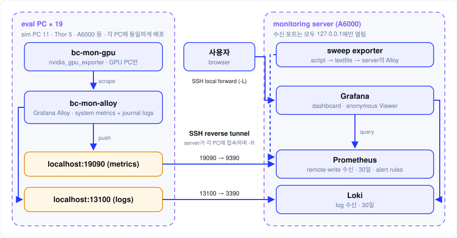

## 한눈에 보기

eval PC마다 **Grafana Alloy** 에이전트를 띄워 메트릭과 로그를 모으고, 이를 **SSH reverse tunnel**로 모니터링 서버(A6000)에 보냅니다. 서버에서는 **Prometheus**(메트릭)와 **Loki**(로그)가 받아 저장하고, **Grafana** 대시보드 하나로 전체 PC를 봅니다.



| 구성 요소 | 위치 | 역할 |
|---|---|---|
| Grafana Alloy (`bc-mon-alloy`) | 모든 eval PC | CPU·메모리·디스크·네트워크 메트릭과 journal 로그 수집, 서버로 push |
| nvidia_gpu_exporter (`bc-mon-gpu`) | GPU가 있는 PC | GPU 메트릭 노출. Alloy가 읽어서 함께 보냄 |
| Prometheus | 모니터링 서버 | 메트릭 수신(remote-write), 30일 보관, 알림 규칙 |
| Loki | 모니터링 서버 | 로그 수신, 30일 보관 |
| Grafana | 모니터링 서버 | 대시보드, 로그인 없이 보기(anonymous Viewer) |

대상은 sim PC 11대, Thor 5대, A6000 등 모두 19대입니다.

## 1. 수집: 각 PC의 Alloy

각 PC에는 배포 스크립트가 `agent.sh`와 Alloy 설정을 복사하고, `agent.sh`가 컨테이너를 띄웁니다. 모든 PC가 같은 구성이라 새 PC를 추가할 때도 같은 스크립트로 붙일 수 있습니다.

```
~/.bc-monitoring/
  ├─ agent.sh          컨테이너 기동
  └─ alloy/
      ├─ base.alloy    CPU·메모리·디스크·네트워크 + journal 로그
      └─ gpu.alloy     GPU PC만 (bc-mon-gpu를 읽음)
```

- **Alloy 하나로 메트릭과 로그를 함께** 모읍니다. 메트릭은 Prometheus로, 로그는 Loki로 보냅니다. PC마다 에이전트를 여러 개 띄울 필요가 없습니다.
- **GPU는 별도 exporter**가 노출하고 Alloy가 읽습니다. GPU 설정(`gpu.alloy`)은 GPU가 있는 PC에만 들어가고, Thor에는 GPU exporter를 띄우지 않습니다.

## 2. 전송: push + SSH reverse tunnel

Alloy는 메트릭과 로그를 **자기 PC의 localhost로 push**합니다. 이 localhost 포트는 SSH reverse tunnel을 통해 모니터링 서버로 이어집니다.

| 데이터 | PC 쪽 (localhost) | 서버 쪽 |
|---|---|---|
| 메트릭 | `19090` | Prometheus `9390` |
| 로그 | `13100` | Loki `3390` |

- **터널은 서버가 엽니다.** 모니터링 서버가 각 PC에 SSH로 접속하면서 `-R` 옵션으로 PC의 localhost 포트를 서버 포트에 연결합니다. PC당 터널 하나를 tmux 창 하나로 유지합니다.
- **서버의 수신 포트는 `127.0.0.1`에만 열려 있습니다.** 외부에 포트를 노출하지 않아도 터널로 데이터가 들어옵니다.
- **모든 PC의 설정이 같습니다.** 각 PC는 서버 주소를 몰라도 자기 localhost로만 보내면 됩니다.

## 3. 저장과 알림

Prometheus는 remote-write로 메트릭을 받고, Loki는 로그를 받습니다. 둘 다 **30일** 보관합니다.

Prometheus에는 fleet 알림 규칙이 있습니다.

| 규칙 | 감지하는 상황 |
|---|---|
| `BoxStoppedReporting` | PC가 메트릭을 더 이상 보내지 않음 |
| `GpuMemoryHigh` | GPU 메모리 사용량이 높음 |
| `LaneWithoutSim` | lane이 잡혀 있는데 sim이 돌고 있지 않음 |
| `RootDiskLow` | 루트 디스크 여유 공간이 부족함 |

## 4. sweep 메트릭: textfile

평가 sweep 진행 상황 같은 사용자 정의 지표는 **별도 exporter 없이 파일로** 내보냅니다.

1. 서버의 스크립트가 sweep 상태를 Prometheus 텍스트 형식 파일(`bc_sweep.prom`)로 씁니다.
2. 서버에서 도는 Alloy가 이 파일을 읽어 다른 메트릭과 함께 Prometheus로 보냅니다.

지표를 하나 늘릴 때 파일에 한 줄만 더 쓰면 되어서, 새 exporter를 만들 필요가 없습니다.

## 5. 보기: Grafana

Grafana도 `127.0.0.1`에만 열려 있어서, **SSH local forward(`-L`)** 로 내 PC의 포트를 서버의 Grafana 포트에 연결해서 봅니다. 대시보드는 `bc-fleet` 하나이고, 로그인 없이 볼 수 있는 anonymous Viewer로 열려 있습니다.

```bash
ssh -N -L 3300:127.0.0.1:3300 <모니터링 서버>
# 브라우저에서 http://localhost:3300/d/bc-fleet
```
