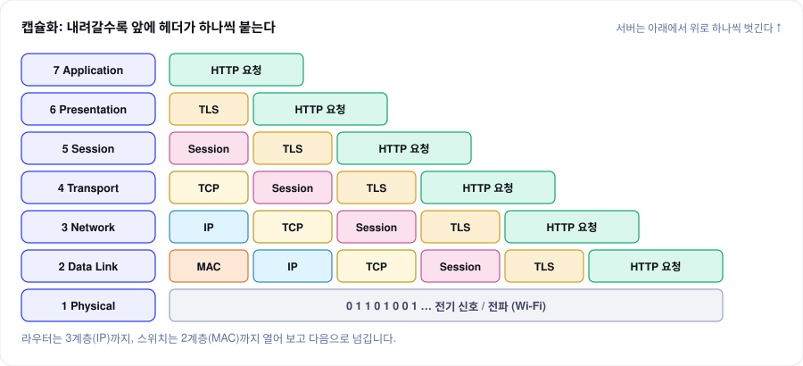

## 한눈에 보기

KodeKloud의 [The OSI Model: 7 Layers Explained with HTTP Request](https://www.youtube.com/shorts/xuan1dN9bKw)를 보고 직접 실습했습니다. 영상은 `example.com`에 보내는 HTTP 요청 하나가 7개 계층을 내려가며 헤더를 하나씩 덧씌우고(**캡슐화**), 서버가 이를 거꾸로 벗겨 내는(**역캡슐화**) 과정을 보여 줍니다.



영상의 예시 값을 그대로 외우는 대신, 네 가지를 직접 해 봤습니다.

| 실습 | 계층 | 확인한 것 |
|---|---|---|
| 요청 하나 따라가기 | 1–7 | 실제 HTTPS 요청에서 계층별로 붙는 값 |
| TCP 구현 | 4 | 연결 지향, 바이트 스트림, 프레이밍 |
| UDP 구현 | 4 | 비연결, 메시지 경계, 손실 |
| HTTP/2 스트리밍 | 7 (TLS 위) | 연결 하나에서 여러 스트림을 동시에 |

전체 코드는 [labs/osi-network](https://github.com/kimgeuneon/gelog/tree/main/labs/osi-network)에 있습니다.

## 1. 요청 하나 따라가기

내 Mac에서 `example.com`에 HTTPS 요청을 보내면서 계층마다 실제 값을 출력했습니다(`trace_layers.py`). 사설 IP와 MAC 주소는 일부를 가렸습니다.

```
[7 Application ] HTTP/1.1 200 OK  <- GET /
[6 Presentation] TLSv1.3, TLS_AES_256_GCM_SHA384, 인증서 CN=example.com
[5 Session     ] keep-alive: 요청 2번 모두 같은 연결 (local port 61753, 61753)
[4 Transport   ] TCP 10.40.x.x:61753 -> 104.20.23.154:443
[3 Network     ] example.com = 104.20.23.154, 첫 라우터(게이트웨이) 10.40.x.x
[2 Data Link   ] en0 MAC 02:dc:xx:xx:xx:xx -> 게이트웨이 MAC 00:00:xx:xx:xx:xx
[1 Physical    ] en0: Wi-Fi 802.11ax, 채널 21 (6GHz, 80MHz)
```

| 계층 | 영상의 예시 | 직접 확인한 값 | 확인 방법 |
|---|---|---|---|
| 7 Application | `GET /index.html HTTP/1.1` | `HTTP/1.1 200 OK` | 소켓에 HTTP 요청을 직접 씀 |
| 6 Presentation | TLS 1.3, AES-256-GCM | TLS 1.3, `TLS_AES_256_GCM_SHA384` | `ssl` 소켓의 협상 결과 |
| 5 Session | Session ID 12345 | keep-alive로 같은 연결 재사용 | 두 요청의 local port 비교 |
| 4 Transport | 54321 → 443 | 61753 → 443 | `getsockname()` |
| 3 Network | 192.168.1.100 → 93.184.216.34 | 10.40.x.x → 104.20.23.154 | DNS 조회, 라우팅 테이블 |
| 2 Data Link | AA:BB:… → 11:22:… | 내 MAC → **게이트웨이** MAC | `arp` |
| 1 Physical | 전기 신호, Wi-Fi | Wi-Fi 6E (802.11ax, 6GHz) | Wi-Fi 정보 |

- **4계층의 출발 포트**는 운영체제가 요청마다 임의로 고르는 임시 포트입니다. 실행할 때마다 61752, 61753처럼 바뀌었습니다.
- **2계층의 목적지 MAC은 서버가 아니라 게이트웨이**입니다. MAC 주소는 같은 네트워크 안에서만 쓰이므로, 프레임은 첫 라우터까지만 가고 거기서 새 MAC 헤더로 바뀝니다. 반면 목적지 IP(3계층)는 끝까지 그대로입니다. 출발 IP는 사설 IP(`10.40.x.x`)라서 네트워크 출구의 NAT에서 공인 IP로 바뀝니다.
- **5계층**은 실제 TCP/IP에서는 따로 떨어진 계층이 아니어서, 같은 연결을 재사용하는 HTTP keep-alive로 "대화 유지"를 확인했습니다.

## 2. TCP 구현

TCP는 **연결을 먼저 맺고**, 데이터를 **경계 없는 바이트 흐름**으로 보냅니다.

```python
for m in [b"hello", b"world", b"tcp"]:
    writer.write(m)            # 세 번 따로 보냄

# 받는 쪽
while chunk := await reader.read(1024):
    received.append(chunk)
```

```
[1] 서버 없이 연결 시도
    -> ConnectionRefusedError: Connect call failed ('127.0.0.1', 9001)
[2] 프레이밍 없이 write 3번
    보낸 것: [b'hello', b'world', b'tcp']
    받은 것: [b'helloworldtcp']  -> read 1번
[3] 4바이트 길이 + 본문으로 프레이밍
    받은 것: [b'hello', b'world', b'tcp']  -> 메시지 3개로 복원
```

- 서버가 없으면 **연결 단계에서 바로 실패**합니다. 상대가 있는지 먼저 확인하는 구조입니다.
- 세 번 보낸 메시지가 **한 덩어리로 도착**했습니다. TCP는 바이트 순서만 보장하고 "어디까지가 한 메시지인지"는 모릅니다.
- 그래서 앞에 **4바이트 길이를 붙이는 프레이밍**으로 경계를 직접 표시해야 합니다. 받는 쪽은 길이를 먼저 읽고 그만큼만 읽습니다.

```python
writer.write(struct.pack("!I", len(m)) + m)        # 보내기: 길이 + 본문
length, = struct.unpack("!I", await reader.readexactly(4))
message = await reader.readexactly(length)         # 받기: 길이만큼
```

## 3. UDP 구현

UDP는 **연결 없이** 데이터그램 단위로 보냅니다.

```
[1] 아무도 듣지 않는 포트로 sendto
    -> 7바이트 전송, 에러 없음 (상대가 있는지 모름)
[2] sendto 3번
    받은 것: [b'hello', b'world', b'udp']  -> recvfrom 3번, 경계 유지
[3] 수신 측이 읽지 않는 동안 5000개 연속 전송 (1024B씩, 번호 붙임)
    받은 개수: 62 / 5000  (사라짐 4938개, 송신 실패 0개)
    받은 번호 범위: 0 ~ 61
```

- 받는 쪽이 없어도 **보내기는 성공**합니다. TCP와 달리 상대를 확인하는 단계가 없습니다.
- 세 번 보내면 **세 번 따로** 받습니다. 메시지 경계가 그대로 유지되므로 TCP 같은 프레이밍이 필요 없습니다.
- 받는 쪽 버퍼(64KB)가 차자 **나머지 4,938개가 에러 없이 사라졌습니다.** 송신 쪽은 실패를 알 수 없고, 재전송도 없습니다. 손실이 문제라면 번호를 붙여 확인하는 일은 애플리케이션 몫입니다.

## 4. HTTP/2 스트리밍 구현

HTTP/2는 **TCP 연결 하나 위에서 여러 요청(스트림)을 동시에** 주고받습니다. 서버는 요청마다 0.3초 간격으로 청크 5개를 흘려 보내고, 클라이언트는 연결 하나로 요청 3개를 한꺼번에 보냈습니다.

```python
raw = socket.create_connection((HOST, PORT))           # 4계층: TCP 연결 1개
tls = ctx.wrap_socket(raw, server_hostname="localhost") # 6계층: TLS + ALPN "h2"

for name in ["a", "b", "c"]:                            # 같은 연결 위에 스트림 3개
    sid = conn.get_next_available_stream_id()
    conn.send_headers(sid, [(":method", "GET"), (":path", f"/stream/{name}"), ...], end_stream=True)
```

```
[L4] TCP  127.0.0.1:61749 -> 127.0.0.1:8443
[L6] TLS  TLSv1.3, TLS_AES_256_GCM_SHA384
[L7] ALPN 협상 결과: h2
[req] stream 1 -> /stream/a
[req] stream 3 -> /stream/b
[req] stream 5 -> /stream/c
   0.0s  stream 1: a-0
   0.0s  stream 3: b-0
   0.0s  stream 5: c-0
   0.3s  stream 1: a-1
   0.3s  stream 3: b-1
   0.3s  stream 5: c-1
   ...
   1.2s  stream 5: c-4
총 1.5s, TCP 연결 1개로 스트림 3개 완료
```

- **TLS 핸드셰이크 안에서(ALPN) `h2`로 합의**한 뒤 HTTP/2로 통신합니다. 계층으로 보면 4계층(TCP) 위에 6계층(TLS), 그 위에 7계층(HTTP/2)이 올라간 모양입니다.
- 클라이언트가 여는 스트림 번호는 **1, 3, 5처럼 홀수**입니다.
- 세 응답의 청크가 **같은 연결 위에서 번갈아** 도착했습니다(멀티플렉싱). 하나씩 차례로 받았다면 4.5초가 걸릴 일이 1.5초에 끝났습니다.
- 서버 로그에도 세 요청이 모두 `HTTP/2`로 찍혔습니다.

## 정리

| | TCP | UDP | HTTP/2 |
|---|---|---|---|
| 계층 | 4 | 4 | 7 (TCP·TLS 위) |
| 연결 | 먼저 맺음 | 없음 | TCP 연결 1개를 공유 |
| 메시지 경계 | 없음 (프레이밍 필요) | 유지 | 프레임 단위로 나눔 |
| 전달 보장 | 순서·재전송 보장 | 없음 | TCP가 보장 |
| 동시성 | 연결 1개 = 흐름 1개 | 데이터그램 단위 | 연결 1개에 스트림 여러 개 |

영상의 마지막 말처럼 이 계층 구분은 시스템 설계에서 바로 쓰입니다. 예를 들어 **L4 로드밸런서**는 IP와 포트(3·4계층)만 보고 나누고, **L7 로드밸런서**는 HTTP 경로나 헤더(7계층)까지 열어 보고 나눕니다. HTTP/2처럼 연결 하나에 요청이 여러 개 실리면 L4에서는 연결 단위로만 나눌 수 있어서, 요청 단위로 나누려면 L7이 필요합니다.
